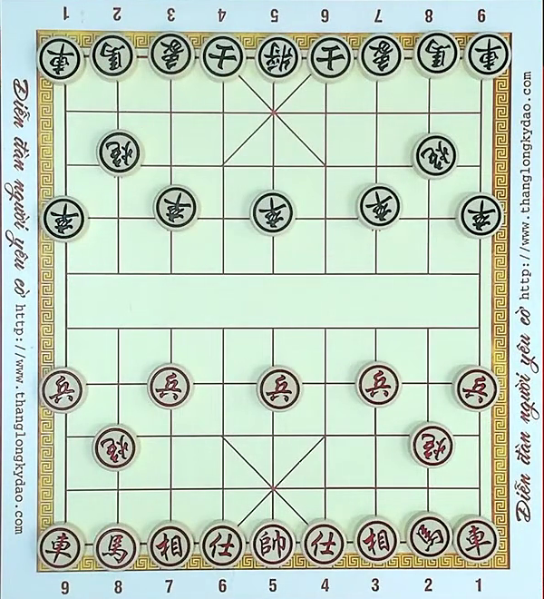
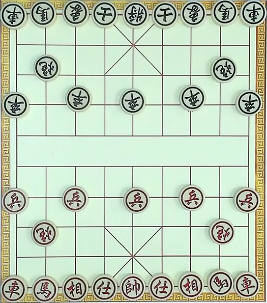
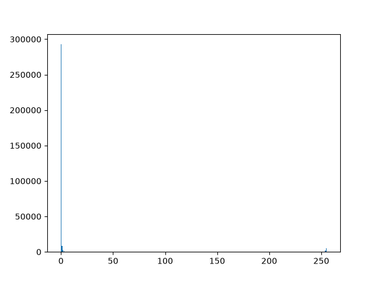
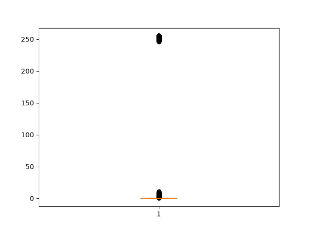
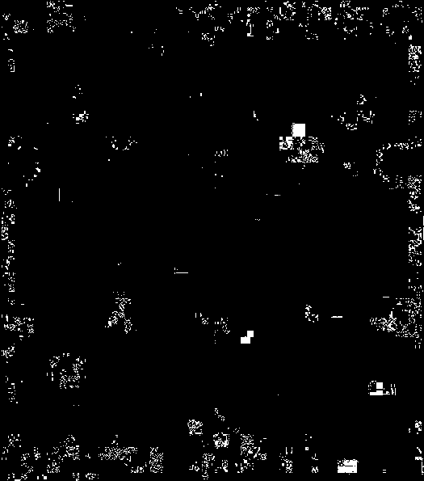
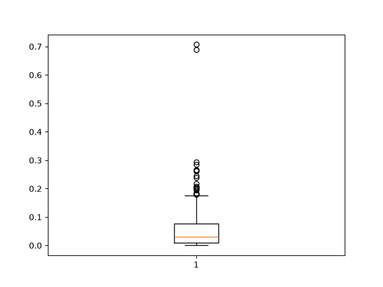
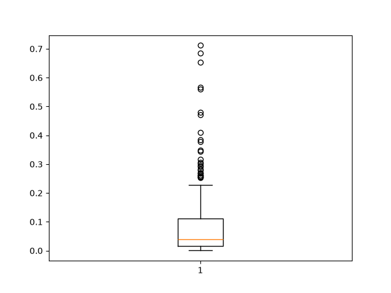
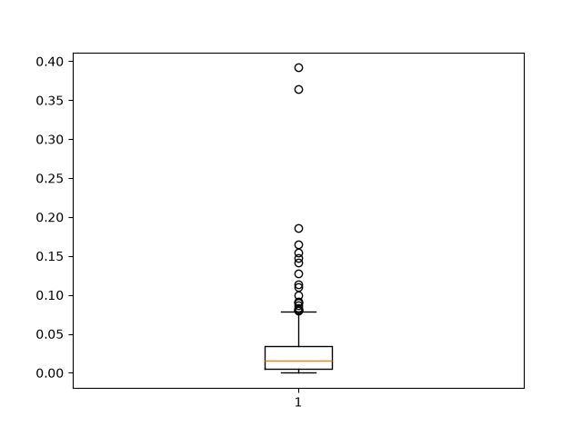
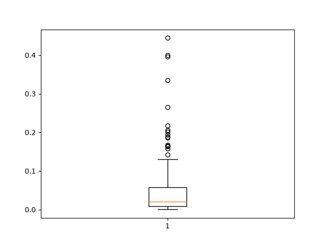

# EDA on Youtube video
Goal: To reproduce steps to explore and resolve the raw video data

## Basic information
+ Video path: `data/bronze/youtube/UvdI37dQFUI_1.mp4`


## Reproduction

### Context

The problem started from extracting frames from video, but with $30$ FPS and more than $2$ hours long, which mean we can extract at least $216000$ frames (or images). But in real world, playing chess requires thinking period, and those period causes many duplicated frames. From that, it is necessary to consider how to extract frames without duplication.

### First idea 

First idea is to check if 2 consecutive frames are unchanged, simply by comparing pixel by pixel.

Resolution of the video is $720 \times 1280$, start at second $16$ (cause at this second the frames don't change).  
After cutting part which contains the chessboard only, the shape becomes $660 \times 600$ ($396000$ pixels in total).  

Visualize them, and they seem to be similar:

| cur_frame | last_frame |
|:-:|:-:|
|  |  |

Convert to grayscale: 

```python
check_frame_changed(
    cv2.cvtColor(cur_frame, cv2.COLOR_BGR2GRAY), 
    cv2.cvtColor(last_frame, cv2.COLOR_BGR2GRAY)
)
```

Run a simple script to count number of pixels changed:
```python
def check_frame_changed(cur_frame: MatLike, last_frame: MatLike):
    pixel_changes = cur_frame - last_frame
    pixel_diffs = pixel_changes != 0
    pixel_changed_count = np.sum(pixel_diffs)

    return pixel_changed_count
```

But there are too many changed pixels: `Pixel changed count: 24116`  
$\rightarrow$ Percent of changed pixels: $24646/396000 = 6.22\%$

### Attempt 1: Cut the image tighter

Intuition: This may be because of little background on the edge and the border of the chessboard  
-> Try to cut the image tighter

From `start_x, end_x, start_y, end_y = (350, 950, 20, 680)` to `(390, 915, 55, 650)`

Visualize:

| cur_frame | last_frame |
|:-:|:-:|
|  |  |

Changed pixels: $19634/312375 = 6.29\%$  
$\rightarrow$ The percent doesn't decrease as expected -> This is not the problem

But still keep analyze on the tighter cut image

### Attemp 2: Show statistics

```python
import pandas as pd

pixels_changed_amounts = [np.sum(pixel_changes == i) for i in range(256)]

df = pd.DataFrame({ "x": list(range(256)), "y": pixels_changed_amounts})
print(df.describe())
```

Result: 

```bash
                x              y
count  256.000000     256.000000
mean   127.500000    1220.214844
std     74.045031   18302.500723
min      0.000000       0.000000
25%     63.750000       0.000000
50%    127.500000       0.000000
75%    191.250000       0.000000
max    255.000000  292741.000000
```

Min change amount is $0$, which is theoretically correct.  
But max change is $255$, which is needed to be clearly explored.  

Draw the bar chart:

```python
fig, ax = plt.subplots()
ax.bar(list(range(256)), pixels_changed_amounts)
```




Draw the boxplot chart:

```python
ax.boxplot(pixel_changes.flatten())
```




$\rightarrow$ Insight: Many pixels are changed slightly (points around $0$) as expected, but there are several pixels are highly changed (outliers)


### Attempt 3: Find out the outliers

Instead of using the upper fence ($\text{Q3} + 1.5 \times \text{IQR}$), checking for Q3 is enough (because the outliers in this case never exceeds $255$). 

Take the threshold amount of the upper fence:

```python
q3_change_threshold = df.quantile(q=0.75) 
q3_change_threshold = q3_change_threshold["x"]  # = 191.25
```

Then take all pixels whose changes exceed the Q3 

```python
exceed_q3_pixels = (pixel_changes > q3_change_threshold) * 255
cv2.imshow("Exceed Q3 pixels", exceed_q3_pixels.astype(np.uint8))
```

Put beside the cut image and visualize them (white color)

| cur_frame | exceed_q3_pixels (white) |
|:-:|:-:|
|  |  |

$\rightarrow$ Insight: As the visualization, most of the changes happen on the pieces (and little happen on the border of the chessboard), and because the pieces haven't been moved, this may be the problem of the light changes outside, which affects the color of the pieces.

### Attempt 4: Tracking the percentage of changes frame by frame

Calculate the percent of changes that exceed the above Q3

```python
pixel_changed_exceed_q3_count = np.sum((pixel_changes > q3_change_threshold))
pixel_changed_exceed_q3_percent = pixel_changed_exceed_q3_count / total_pixels
```

And visualize it by tracking an amount of consecutive frames:

```python
changed_percents.append(pixel_changed_exceed_q3_percent)
ax.boxplot(changed_percents)
```

Examine 2 ranges: Staying frames (no changes, since the game hasn't been started yet) and Moving frames (players start to perform moves), which are `16s - 21s` and `1m2s - 1m7s` respectively.


| total_pixels staying | total_pixels moving |
|:-:|:-:|
|  |  |


| exceed_q3 staying | exceed_q3 moving |
|:-:|:-:|
|  |  |


$\rightarrow$ Insight: The Moving has more pixels changed than the Staying, but the difference is not large enough to separate the 2 states 


### Attempt 5: Try modify the lag

Currently using 2 consecutive frames (lag = 1), but what if comparing frame 1 and frame 3 (lag = 2)


### Second idea: Extract frames eventually 1 seconds, then compare duplicated frames later

Pros: This approach is simple  
Cons: May has duplicate frames, skip players' moves, ... -> Can't control quality of the data

Go for this first, then try the First idea (above) later

